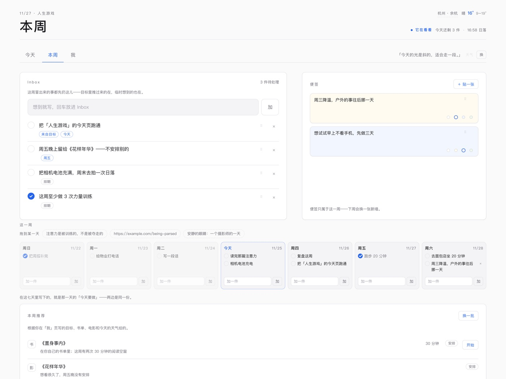
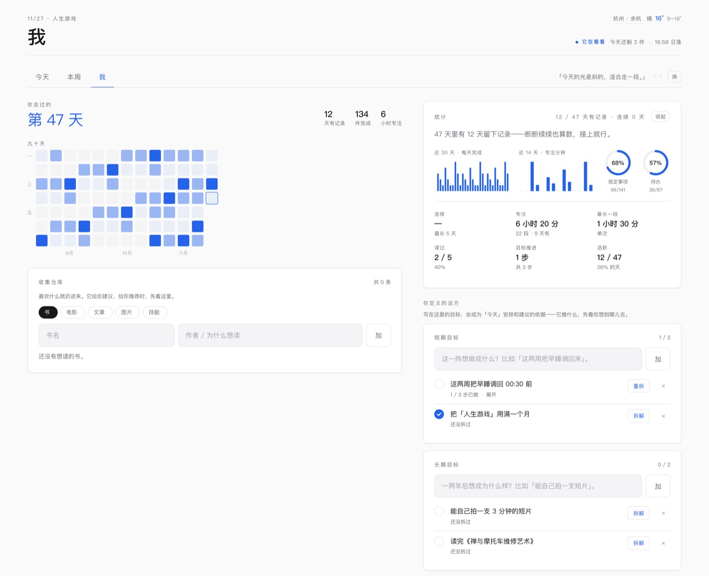

# 人生游戏 · Lifegame

一天一屏，管四件慢功夫：**耐心、轻盈、专注、健康**。

一个 [DeepSeek Harness](https://github.com/) 插件。侧栏一个页面，Agent 在旁边随时推荐，读写同一份数据。

不是待办清单，也不是打卡 App。它只做一件事：**在每天开始的时候，告诉你「今天最重要的三件事」和「你现在该干什么」**，然后让你自己做决定。

<p align="center">
  
</p>

---

## 三个页面

| | |
|---|---|
| **今天** | 现在的下一件事 · 专注计时（全局浮窗可见） · 规定的三件 · 自由待办 · 稍后深度阅读 · 「它在看着」的三条事实 |
| **本周** | 待办箱（可排期到某天） · 便签 · 七天日历 · 建议（可一键安排到某天） |
| **我** | 九十天活跃格（13 周 × 7 天） · 统计与图表 · 短期/长期目标（可拆解成步骤） · 每天的规矩 · 收集仓库 |

<p align="center">
  
  
</p>

---

## 装

需要 DeepSeek Harness 的插件管理。

**从仓库安装**（指向插件目录）：

```
plugin_manager install_bundle <本仓库路径>/plugin
```

**从 tgz 安装**（见 Releases）：

```
plugin_manager install_bundle <下载的>.tgz
```

装完重启 DSH，左侧栏会多一个「人生游戏」。

---

## 数据在哪

**全部存在本机，不上传任何服务器。**

```
$DSH_HOME/lifegame/
├── db.json          ← 唯一真相源
├── db.json.bak      ← 上一次的备份
└── media/           ← 你收藏的图片
```

卸载插件不会删数据。想彻底清除就删掉这个目录。

---

## 它会用到什么

| 用途 | 说明 |
|---|---|
| 大概位置 | 拉天气用，默认「杭州 · 余杭」，页面上可改 |
| 你的模型 | 推荐、目标拆解、每日一句——**只有你点了才会调用** |
| 本地文件 | 收藏的图片落盘到 `media/`，单张上限 8MB |

---

## 目录

```
plugin/        插件本体（host + client + 视图 + 工具）
design/        三屏设计稿（今天 / 本周 / 我），可直接在浏览器打开
doc/           设计文档：001 演进记录、002 手机端、003 数据结构与发布
```

- [设计演进记录（001）](doc/001-生命力系统.md)：这个产品是怎么一步步变成现在这样的
- [数据结构与发布（003）](doc/003-数据结构与发布.md)：db.json 的完整结构、发布清单

---

MIT License
