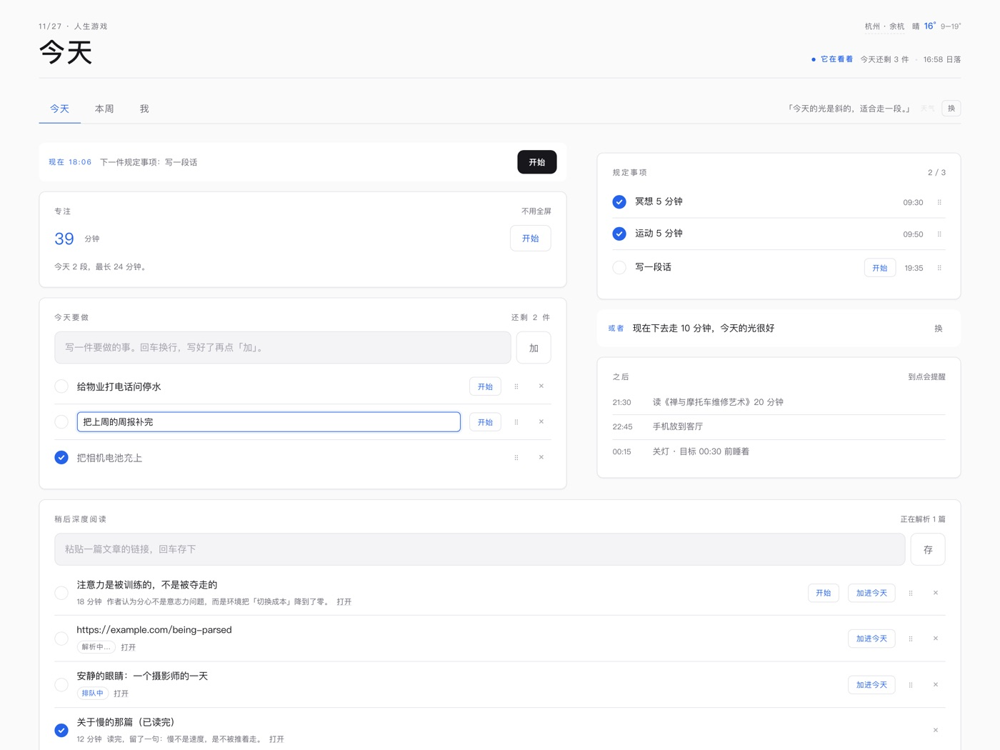
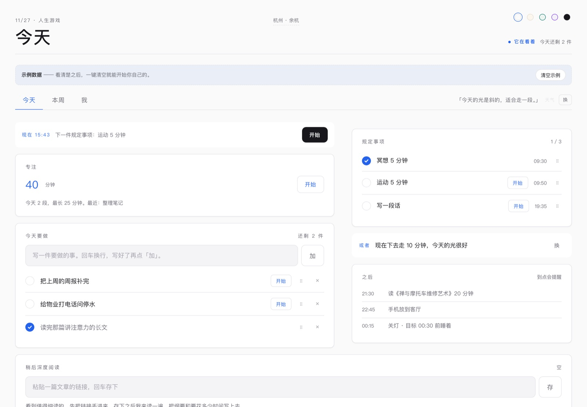
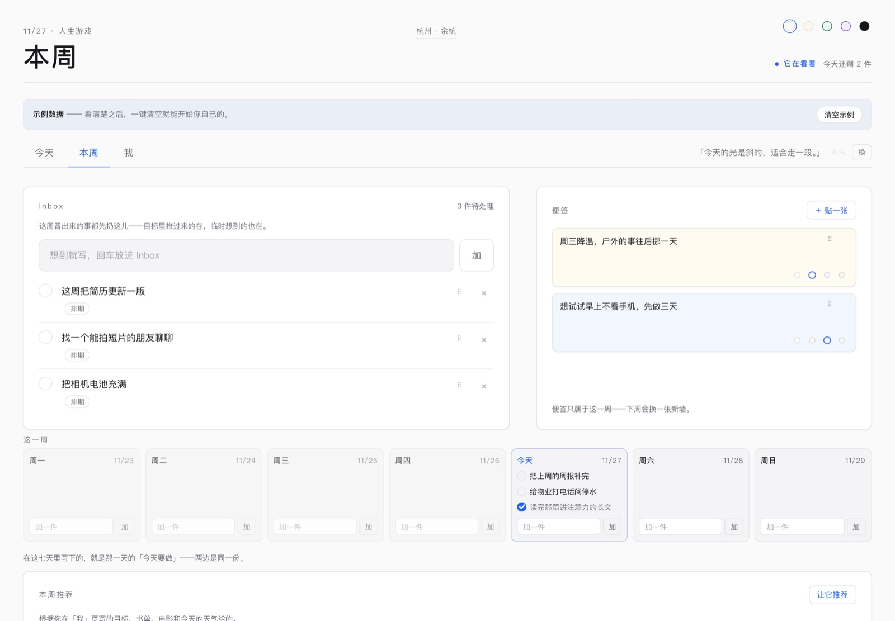
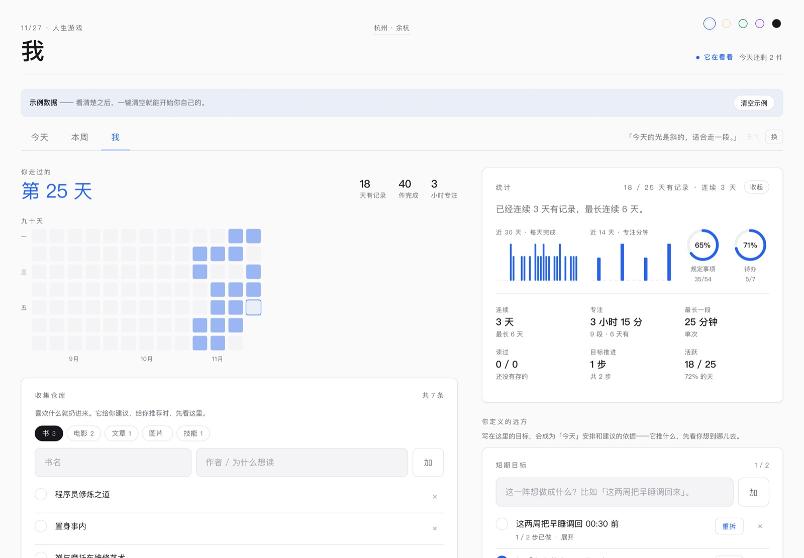

# 人生游戏 · Lifegame

一天一屏，管四件慢功夫：**耐心、轻盈、专注、健康**。

一个 [DeepSeek Harness](https://github.com/) 插件 · [npm](https://www.npmjs.com/package/dsh-lifegame)。侧栏一个页面，Agent 在旁边随时推荐，读写同一份数据。

不是待办清单，也不是打卡 App。它只做一件事：**在每天开始的时候，告诉你「今天最重要的三件事」和「你现在该干什么」**，然后让你自己做决定。

<p align="center">
  
</p>

---

## 三个页面

| | |
|---|---|
| **今天** | 现在的下一件事 · 专注计时（全局浮窗可见） · 规定的三件 · 自由待办 · 稍后深度阅读 · 「它在看着」的三条事实 |
| **本周** | 待办箱（可排期到某天） · 便签 · 七天日历 · 建议（可一键安排到某天） |
| **我** | 九十天活跃格（13 周 × 7 天） · 统计与图表 · 短期/长期目标（可拆解成步骤） · 每天的规矩 · 收集仓库 |

<p align="center">
  
  
</p>

---

## 截图

<p align="center">
  
</p>
<p align="center">
  
  
</p>

---

## 装

需要 DeepSeek Harness（0.2.2 或更新）。

### 方式一：从 npm（最省事）

在 DSH 里：**插件** → **添加插件** → 填 `dsh-lifegame`

或者在对话里说「装 dsh-lifegame 这个插件」，Agent 会调 `plugin_manager` 完成。

### 方式二：从 GitHub 下载

1. 打开 [Releases](https://github.com/yonho01-collab/lifegame/releases)
2. 下载 `dsh-lifegame-1.0.2.tgz`
3. 解压得到 `package` 文件夹
4. **插件** → **添加插件** → 选这个文件夹

### 方式三：从源码（开发者）

```bash
git clone https://github.com/yonho01-collab/lifegame.git
```

然后 **插件** → **添加插件** → 选 `plugin/` 目录。改代码即生效，不用重装。

装完重启 DSH，左侧栏会多一个「人生游戏」。

## 第一次打开会看到什么

装好之后打开，**里面已经有一套示例数据**：几个待办、一周的记录、三条历史、几本书和电影。

这样你能直接看到「用起来是什么样」，而不是对着一片空白猜。

看清楚之后，点顶部的「**清空示例**」——它只删带示例标记的条目，你自己加的记录一个字都不会碰。清空后就是完全属于你自己的空白页。

---

## 数据在哪

**全部存在本机，不上传任何服务器。**

```
$DSH_HOME/lifegame/
├── db.json          ← 唯一真相源
├── db.json.bak      ← 上一次的备份
└── media/           ← 你收藏的图片
```

卸载插件不会删数据。想彻底清除就删掉这个目录。

---

## 它会用到什么

| 用途 | 说明 |
|---|---|
| 大概位置 | 拉天气用，默认「杭州 · 余杭」，页面上可改 |
| 你的模型 | 推荐、目标拆解、每日一句——**只有你点了才会调用** |
| 本地文件 | 收藏的图片落盘到 `media/`，单张上限 8MB |

---

## 目录

```
plugin/        插件本体（host + client + 视图 + 工具）
design/        三屏设计稿（今天 / 本周 / 我），可直接在浏览器打开
doc/           设计文档：001 演进记录、002 手机端、003 数据结构与发布
```

- [设计演进记录（001）](doc/001-生命力系统.md)：这个产品是怎么一步步变成现在这样的
- [数据结构与发布（003）](doc/003-数据结构与发布.md)：db.json 的完整结构、发布清单

---

MIT License
