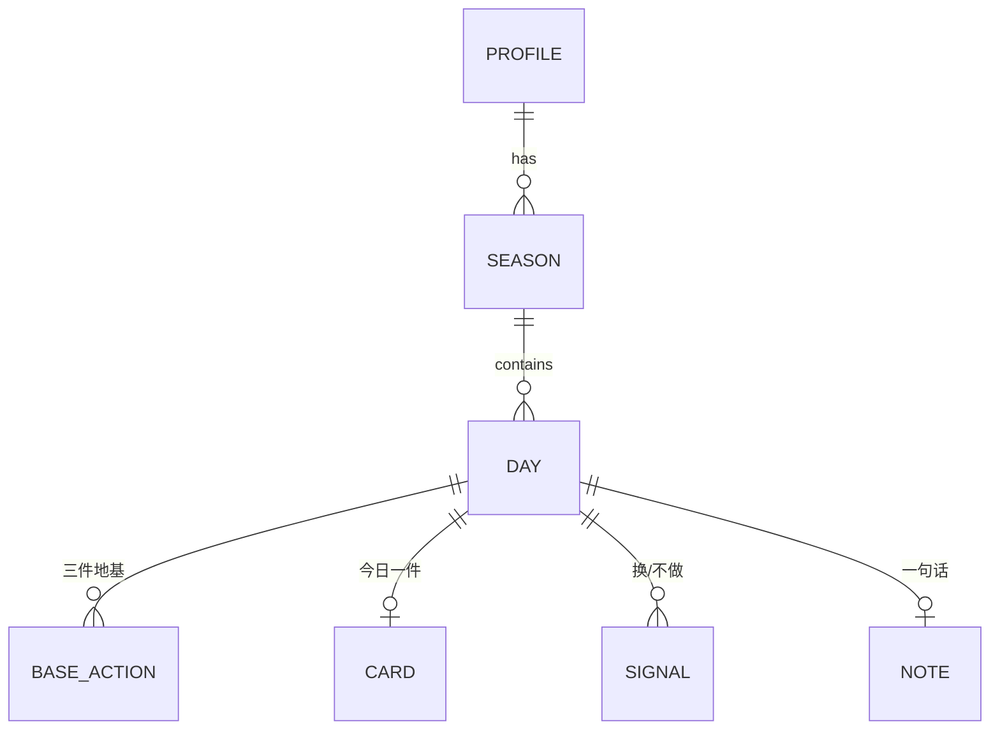

# 001 · 人生游戏（生命力系统）

- **状态**：draft（需求 v2 已收口 · 蓝图待评审；未 approved 不允许写码）
- **创建**：2026-11-25
- **档案阶段**：第 1 步 需求（v1 三轮 + v2 变更）→ 第 2 步 蓝图 → 第 3 步 评审（进行中）
- **v2 变更**：按「极简主义 / 第一等级 / 四字目标 / 常开 Mac / 日期推荐」重做，把 v1 的 7 屏砍到 3 屏
- **v3 变更（2026-11-25 晚）**：今天屏从「清单」改为**「此刻的导演」**；新增**创造信条**、**日历接入**、**到点提醒**、**明天钩子**。见 §19
- **v4 变更（2026-11-25 更晚）**：新增**晨间开场仪式**（今天屏的第一个状态）；取消独立的「今天一件」卡片，推荐并入晨间；本周屏改为**可解释建议 + 换一批 + 推荐三样 + 跟踪**。见 §20
- **v5 变更**：开屏改为**晨间图 + 引言**；四字改为**耐心 / 轻盈 / 专注 / 健康**；「我」屏重做为**自画像**；主动性首次**可视化**（「它在看着」）。见 §21
- **v6 变更**：**动作按类型分三种界面**（产出 / 时间 / 事件），修掉「写 200 字套计时器」的错；立两条设计纪律：**计划不复述**、**每个动作都要写明去向**；今天屏增加「或者」建议路径。见 §22
- **v7/v8 变更**：删除「我」屏的四字口号大字与「创造信条」；**创造力改为以「做」类推荐呈现，不设配额、不喊口号**。见 §23 / §24

---

## 1. 背景与症状

大厂在职，收入尚可，晋升空间有限；出差频繁（不固定，看项目），可自主支配时间多。

| 症状 | 描述 |
|------|------|
| 空虚 | 一天天上班，没有进步，每天处于「无任务状态」 |
| 懈怠 | 有任务时也很容易懈怠 |
| 专注力差 | 阅读专注力下降，专注力非常不够 |
| 机能下降 | 身体机能在降低 |
| 好奇心下降 | 对外界的探索欲在降低 |
| 浮躁 | 心态浮躁，需要先降下来（v1 已确认为报复性熬夜 + 刷手机） |

**作息事实**：01:30–02:00 睡，09:00 起；约 18:00–19:00 下班，通勤很近；不出差时公司—住处两点一线。
→ 每天有 **6.5 小时**完全自主时间，但没有归属。这是空虚的结构性来源。

**已启动的正向变化**：最近开始冥想（每天 10 分钟），健身重新启动。

---

## 2. 根因假设（已确认）

1. **反馈闭环缺失**：努力与回报脱钩，做了事没人看见、没有积累感。
2. **节律缺失**：无任务态不是懒，是日程里没有「被期待的事」。人是被「下一个期待」驱动的。
3. **低刺激沉浸入口缺失**：注意力阈值被高刺激内容抬高，读书/运动这类「低刺激高回报」的事启动成本极高。

### 三条反直觉判断（已认可）

- **R1**：继续推荐更多好内容会加重问题。内容必须是**处方**（限量、有疗程），不是信息流。
- **R2**：不能再叠积分/等级/连续打卡。度量用体验型指标，不用完成率。
- **R3**：主动 ≠ 随时推送。主动 = 固定节律点出现 + 选择权在人手上。

### v2 新增判断

- **R4（极简优先）**：任何需要用户「做决定」的地方都要砍掉或后置。**能替用户决定就替他决定**，只在结果上给他「换一个 / 不做」的否决权。
- **R5（分层优先）**：地基动作（冥想/健身/睡觉）与趣味推荐（读书/看展/约人）**不在同一个池子里竞争**。混在一起会让地基被趣味挤掉。

---

## 3. 产品主张

> 一个**只在一屏里每天陪你的极简系统**。它替你做决定，你只需要三个动作：**做 / 换一个 / 不做**。

日常只记录不计算；计算交给 Agent 每周做一次。

---

## 4. 四字目标模型（用户自己的话）

**充实 · 轻盈 · 专注 · 健康**

| 维度 | 定义（可测的代理指标） | 每日信号 |
|------|------------------------|----------|
| **健康** | 睡得够 + 身体在动 | 昨晚睡眠时长、是否运动 |
| **专注** | 有注意力训练 + 有沉浸时间 | 冥想是否完成、深度时段分钟 |
| **轻盈** | 睡前那一小时怎么过的 + 今天的心理感受 | 睡前是否离床、感受分 |
| **充实** | 今天有没有留下东西 | 今天一件是否完成、是否写了那句话 |

说明：这是**代理指标不是精确测量**。极简原则下宁可用粗糙但真实的信号，不要精确但没人填的问卷。

> 🔴 **待确认**：「轻盈」是否就是这个意思（身体的轻 + 心里不积压）？如果你指的是别的（比如物欲/体重/房间整洁），现在改成本最低。

---

## 5. 两级动作模型（v2 核心）

| 等级 | 内容 | 频率 | 谁决定 |
|------|------|------|--------|
| **第一等级 · 地基** | 冥想 10 分钟 / 动一动 20 分钟 / 睡前把手机放到客厅 | 每天固定三件 | 固定，**不推荐、不变化** |
| **第二等级 · 趣味** | 阅读、长电影、探索、审美、连接、创造 | 每天**一件** | Agent 推荐，用户可换/可不做 |

**为什么这样分**：地基是「让生命力回来」，趣味是「让生活有趣」。地基不需要意志力和灵感，趣味才需要选择。混在一起，地基永远打不过趣味。

---

## 6. 推荐引擎（v2 新增 · 核心）

每天 **09:10** 由 Agent 生成一张卡（只有一张）。

**输入信号**

1. 四维近 14 天数据 → 找出最弱的一维
2. 当前日期 / 节气 / 节日（例：2026-11-26 是感恩节）
3. 最近 14 天做过什么 → 去重
4. 今天的场景（在家 / 公司 / 出差）
5. 昨晚睡眠（睡太晚 → 给低消耗的）

**输出结构**

```json
{
  "title": "给一个很久没联系的人发条消息",
  "why": "充实这一维两周没动过；今天是感恩节。只要 5 分钟。",
  "minutes": 5,
  "budget": 0,
  "scene": "home",
  "dimension": "充实",
  "source": "calendar"
}
```

**三个操作**：`做` / `换一个` / `今天不做`。后两个都记信号，用于调参。

**节日/日期推荐的定位**：不是内容库，是**惊喜触发器**。它解决「人生有没有创意」这个问题，成本极低。

---

## 7. 系统结构（v2 压缩为三层）

```
采集层   本地 Web App（PWA）：三件地基打勾、今天一件、一句话、周复盘
          ↓ data/db.json（唯一真相源）
决策层   DSH 会话（Agent）：读数据 → 写今日卡 / 周复盘叙事
          ↑
唤醒层   DSH 调度：09:10（今日卡）/ 周日晚（复盘）
```

---

## 8. 首版范围（极简 MVP · 4 屏）

| 屏 | 文件 | 内容 |
|----|------|------|
| **今天** | `design/today.html` | **此刻**（唯一的当前动作 + 大按钮）+ 之后节点 + 今天一件（做/换/不做）+ 明天钩子 |
| **专注** | `design/focus.html` | 只有动作名 + 倒计时 + 完成；无 tabbar、无通知、无其他入口 |
| **这周** | `design/week.html` | Agent 写的一份周报：叙事 + 四维趋势 + 三条建议 + 留下的话 + 下周加码 |
| **我** | `design/me.html` | 四字目标 + 创造信条 + 当前季/下一季 + 五个设置 + 数据导出 |

**不在 MVP**：菜单选择、证据照片、年鉴、形象购物、内容库、社交、多用户、出差模式开关（改为自动推断）。

---

## 9. 非目标

- 不做积分、等级、排行榜、连续打卡
- 不做社交
- 不做无限内容流
- 不自动排满日程（必须留白）
- 不做医疗/健康建议
- **不做需要用户主动规划的功能**（极简原则）

---

## 10. 用户故事

- **US1** 作为用户，我早上打开只有一屏，看到昨晚睡眠 + 三件地基 + 一张今日卡，10 秒能看懂。
- **US2** 作为用户，我不想选的时候，系统直接给我一件；不满意我点「换一个」。
- **US3** 作为用户，三件地基是固定的，不需要我思考今天要不要冥想。
- **US4** 作为用户，周日我只看一眼四维横条和一句诊断，不做任何规划。
- **US5** 作为用户，出差时没有网也能打开、能打勾，回到网络自动同步。
- **US6** 作为用户，我连续几天什么都没做时，系统不催我、不显示中断，只把剂量调低。

---

## 11. 验收标准

- **AC1** Given 我早上 09:10 后打开应用，When 首页加载完成，Then 一屏内同时看到：昨晚睡眠、三件地基、一张今日卡；无需滚动即可看到今日卡标题。
- **AC2** Given 今日卡不满意，When 点「换一个」，Then 3 秒内换一张不同卡片，且原卡记录为 skipped。
- **AC3** Given 我点「今天不做」，When 提交，Then 记 skipped 且**不出现任何劝阻或失败措辞**。
- **AC4** Given 我连续 3 天没有任何勾选，When 打开应用，Then 页面正常显示，且今日卡自动降为 ≤10 分钟的版本。
- **AC5** Given 我离线打勾 3 项，When 恢复网络，Then 3 条记录自动同步且不重复。
- **AC6** Given 今天是 11/26 感恩节，When 生成今日卡，Then 卡片 `source` 为 calendar 且 why 里说明了节日依据。
- **AC7** Given 一周结束，When 打开「这周」，Then 四维各自有一个 0–7 的达成天数与一句诊断，无完成率、无排名。

---

## 12. 不良路径与边界

| 场景 | 期望行为 |
|------|----------|
| Agent 未按时产出今日卡 | 用「昨日卡 + 降级默认动作」兜底，界面不空白、不报错 |
| inbox JSON 损坏 | 忽略该文件并记录 parse_error，界面照常可用 |
| 离线 | 读本地缓存，写入进队列，联网重放（幂等） |
| 出差（陌生城市） | 今日卡自动偏向「探索」，场景字段由城市变化推断 |
| 睡太晚（>02:00） | 今日卡自动降档，不给消耗大的事 |
| 用户长期不上线 | 只降频不催命：第 7 天一条「这周不用做什么」，第 21 天停推 |
| 节假日误判 | 卡片标注依据，用户可「换一个」直接覆盖 |

---

## 13. 决策记录

| 编号 | 决策 | 结论 | 版本 |
|------|------|------|------|
| Q1 | 用户范围 | 只给自己用，单用户无登录 | v1 |
| Q2 | 形态 | 本地 Web App + 每日简报 | v1 |
| Q3 | MVP | 先做日常闭环，不做内容库 | v1 |
| Q4 | 数据来源 | 纯手动，预留健康/日历接口 | v1 |
| Q5 | 简报通道 | DSH 原生唤醒链 + DSH Go | v1 |
| Q6 | 降噪力度 | 温和起步，两周后加码 | v1 |
| Q7 | 作息 | 01:30–02:00 睡 / 09:00 起 | v1 |
| Q8 | 每日投入 | 系统交互 10 分钟 + 一个 30 分钟动作 | v1 |
| **Q9** | 部署形态 | **部署到另一台常开的 Mac 作为常驻服务** | v2 |
| **Q10** | 离线 | **离线可用**（见 §14 的更简实现） | v2 |
| **Q11** | 四维模型 | 用用户自己的词：充实/轻盈/专注/健康 | v2 |
| **Q12** | 交付形态 | **极简优先**：3 屏，能砍就砍 | v2 |
| **Q13** | 选择方式 | **取消周菜单选择**，改为每日推荐一件 + 换一个 | v2 |
| **Q14** | 内容储备 | **第二季（重启身体季）现在就备好** | v2 |

### v1 → v2 的重要变更

| 变了什么 | v1 | v2 | 为什么 |
|---|---|---|---|
| 维度模型 | 五维（身体/专注/探索/审美/连接） | **四维（充实/轻盈/专注/健康）** | 用户自己的话更准 |
| 选择权 | 每周从 3–5 张卡里选 1–3 个 | **每天给一件，可换可不做** | 用户无目标性 + 极简 |
| 层级 | 单一池子 | **第一等级地基 / 第二等级趣味** | 地基不能被趣味挤掉 |
| 屏数 | 7 屏 | **3 屏** | 极简 |
| 雷达 | 五维雷达图 | **四维横条** | 雷达看着专业，读起来累 |
| 出差 | 手动开关 | **自动推断** | 少一个需要用户做的事 |
| 同步 | last-write-wins 双写 | **服务端唯一真相源 + 离线队列重放** | 少一半逻辑 |

---

## 14. 架构（常开 Mac + 离线队列）

```
[手机 PWA]  ←HTTP→  [常开 Mac：静态资源 + 极小 API]
                          ↓
                     data/db.json   ← 唯一真相源（带 rev）
                          ↑
                  [DSH 会话（Agent）] ← 09:10 / 周日晚 由调度唤醒
```

**离线怎么做到极简**：不做双向同步。手机端只做两件事——缓存最后一次读到的 db 快照、把没发出去的写操作放进队列；恢复网络后按序重放（每条写带唯一 `opId`，服务端幂等去重）。服务端永远是唯一真相源，不存在两写冲突。

> 这比 v1 设想的 last-write-wins 简单一半，且完全满足出差可用。

**部署前提**（待确认）：常开的那台 Mac 需要装 DSH 并接上 DSH Go，才能做到「主动唤醒」。

---

## 15. 蓝图

### 15.1 界面全局（3 屏）

| 屏 | 作用 | 出去 |
|----|------|------|
| **今天** `today.html` | 此刻一件事 + 之后节点 + 今天一件 + 明天钩子 | → 专注 |
| **专注** `focus.html` | 只做这一件事，屏幕里没有别的 | → 今天 |
| **这周** `week.html` | Agent 写的周报，不是数据面板 | ← 今天 |
| **我** `me.html` | 目标 / 信条 / 季 / 设置 / 导出 | ← 今天 |

**为什么是 4 屏不是 3 屏**：v2 砍到 3 屏是对的，但「做的时候要专注」这句要求必须有一块**专门的屏幕**来承载——它不能是今天屏里的一个状态，否则用户永远在那儿看别的。这一屏的规则是：**进去之后屏幕上没有第二件事**。

### 15.2 数据全局



| 文件 | 唯一写入者 | 内容 |
|------|-----------|------|
| `data/db.json` | 服务端 API | profile / season / day / base_action / card / signal / note；带 `rev` |
| `data/inbox/card-YYYY-MM-DD.json` | Agent | 今日卡（含 why / source） |
| `data/inbox/review-YYYY-Www.json` | Agent | 周复盘叙事 |

**四条不变量**：
1. app 只通过 API 写 db，Agent 只写 inbox —— 不存在并发写。
2. 每条离线写都带 `opId`，服务端幂等去重。
3. 今日卡缺失时用降级动作兜底，任何情况下首页不空白。
4. 四维只在周复盘计算，日常不计算。

### 15.3 交付全局（5 片，每片可独立验证）

| 片 | 范围 | 验证方式 |
|----|------|----------|
| **S1** | 数据层 + 今天屏（三件地基能打勾、能写一句话） | 在本机跑起来，真的用它过一天 |
| **S2** | 今日卡（先用本地规则生成，不接 Agent）+ 换一个/不做 | 点十次「换一个」，看卡片是否合理 |
| **S3** | 这周屏（四维横条 + 诊断）+ 我（设置） | 造 7 天假数据，检查数字对不对 |
| **S4** | 接 Agent + 09:10 唤醒 + 节日/节气推荐 | 真实跑一周，看主动唤醒是否到手机 |
| **S5** | 部署常开 Mac + 离线队列 + DSH Go | 出差时实测离线打勾再同步 |

---

## 16. 评审三问

**① 改哪层** — 三层：`app/`（PWA 采集呈现）、`api/`（读写 db.json，极小）、`agent/`（读 db 出卡与复盘）。不越层，唯一耦合面是 `data/`。

**② 数据怎么流，失败怎样** — 见 §15.2 四条不变量。失败兜底：Agent 没出卡 → 用降级默认；inbox 坏 → 忽略；离线 → 队列重放；睡太晚 → 自动降档。

**③ 怎么验证** — 每片都有「真实用一天」的验证方式（上表），不靠单测假装通过。数据层单测覆盖 rev 递增、opId 幂等、坏 JSON 容错；四维计算单测覆盖空数据不出 NaN。

**更简单的做法我都试过了**：只做 Todo（解决不了期待感）、用现成打卡 App（正好是要避开的积分机制）、只做 DSH 会话（雷达和积累留不住）。v2 已经是这些方案里最简单的一条。

---

## 17. 第二季储备（Q14）

降噪季只有 14 天，第二季需要**现在备好**，否则第一季结束就会出现断层（正好是产品最容易死的时候）。

- **第二季：重启身体季**（14 天）——重心从「睡前」转到「白天」：力量训练渐进、通勤步行、体感轻盈。
- 备好的东西：14 天的今日卡池（含 why）、四维权重调整、加码规则。
- 第三季候选：城市漫游季 / 审美启蒙季。

---

## 18. 调研种子

- 人生清单范式：[100 件事](http://mp.weixin.qq.com/s?__biz=MzI4NDA2MDMxMQ==&mid=2649015256&idx=1&sn=01702909e541db7080eb8ca43b58f457)
- 生活方式范式：[100 种有趣的生活方式](http://mp.weixin.qq.com/s?__biz=Mzk5MDY3NTYyOQ==&mid=2247560142&idx=2&sn=9811d1b8bb05dcd748456cd32abc8c9d)（自我定位：「不是任务清单，是提醒」）
- 专注与数字极简：[《深度工作》《数字极简》](https://earsonme.com/episodes/021iNxF4QY0w)
- 心力与认知能量：[36 氪](https://36kr.com/p/3431219205803399)
- 好奇心可随年龄保持甚至增长：[UCLA Castel](https://www.ucla.edu/research/article/aging)
- 博物馆/城市审美主线：[播客](https://podcasts.apple.com/sg/podcast/vol-74-%E8%B7%9F%E7%9D%80-%E5%8D%88%E5%A4%9C%E5%B7%B4%E9%BB%8E%E9%80%9B%E5%8D%9A%E7%89%A9%E9%A6%86-%E5%9B%9E%E5%88%B0%E6%B5%B7%E6%98%8E%E5%A8%81%E4%B8%8E%E5%8D%B0%E8%B1%A1%E6%B4%BE%E7%9A%84%E9%BB%84%E9%87%91%E6%97%B6%E4%BB%A3/id1725592948?i=1000766394411)


---

## 19. v3 增量（2026-11-25 晚 · 今天屏评审反馈）

### 19.1 核心修正：今天屏不是清单，是「此刻的导演」

v2 的今天屏是三件地基打勾 + 一张卡 + 一句话 —— **本质还是清单**，用户看着四个勾选框要自己决定先后。

v3 改为**时间轴上的节点**：

```
现在 19:35
─────────────────
此刻   动一动 · 20 分钟        ← 只有一个，且是唯一可执行项
       [开始]  晚点再说
─────────────────
之后   21:30  冥想 10 分钟      ← 只列时间与名字，不可勾选
       22:45  手机放到客厅
       00:15  关灯
─────────────────
今天一件（第二等级，可换/可不做）
明天给你留了一件（钩子）
```

**三条规则**：
1. 界面只把「当前时间窗内的那一个动作」做成可执行的大按钮，其余节点是**只读的未来**。
2. 到点由调度唤醒推送；过点不做的动作自动降级到「明天再说」，**不累积、不显示欠账**。
3. 点「开始」进入**专注屏**——那一屏只有动作名、倒计时、完成按钮。满足「做的时候要专注」。

### 19.2 时间窗（由作息推出，日程覆盖后调整）

| 窗口 | 时间 | 默认动作 |
|------|------|----------|
| 晨间 | 09:20–09:50 | 冥想 10 分钟（起床后先做，最容易守住） |
| 下班后 | 19:00–20:00 | 动一动 20 分钟 |
| 夜间专注 | 21:00–22:30 | 深度时段 / 今日卡（长片、阅读、创造） |
| 收尾 | 22:45 | 手机放到客厅 |
| 睡前 | 00:15 | 关灯 |

**日历覆盖规则**：若某窗口被会议占用 → 该窗口动作顺延到下一个空闲窗口，并在今天屏显示「今天 21:30 之后才有空」。

### 19.3 日历接入（已核实的事实）

- 用户**没有使用 macOS 日历**（`~/Library/Calendars` 不存在）。
- 用户装有 **Lark（飞书）**；DSH 具备 `lark-calendar` 能力，可读日程、查忙闲、推荐时段。
- 结论：**日历主通道走飞书**，macOS 日历作为备选。
- 隐私边界：**只读忙闲与标题**，不读会议详情、不读附件；授权状态在「我」屏可见（原型已显示「飞书日历 · 已连」）。

日历的三种用途：
1. 找空闲窗口 → 决定深度时段排哪
2. 识别会议密集日 → 当天自动降档（今日卡换成 ≤10 分钟的）
3. 识别出差（地点/航班）→ 自动切出差模式（v2 的手动开关就此取消）

### 19.4 到点提醒（新增 · 每天最多 4 条）

| 时刻 | 内容 |
|------|------|
| 09:10 | 今日卡 + 今天第一件事 |
| 动作开始前 5 分钟 | 「19:25 · 20 分钟后有 20 分钟的空」 |
| 22:45 | 手机放到客厅 |
| 00:15 | 关灯 |

**醒着但没睡时**（00:30 后仍检测到活动）：只提醒一次，措辞不责备——「今天到此为止，明天还有一件」。
超过 4 条即视为骚扰，不允许加。

### 19.5 创造信条（Q15）

> 用户原话：人生应该有很多过程是用来创造的，可以是一本书、一张图、一段视频，但不能停止。

- **不是第五维**，是**贯穿四维的信条**：创造同时喂「充实」（留下东西）和「专注」（沉浸）。
- **落地方式**：今日卡增加一个 `source=create` 类别，Agent **每周至少安排 2 张创造卡**（写 200 字 / 拍 30 秒 / 画一张，任选）。
- **不做打卡**：不记连续、不记天数，只在条件满足时由周报提一句「这周创造了 2 次」。
- 「我」屏增加信条区，写死一行：「不断创造 · 每周至少 2 次」。

### 19.6 明天钩子（期待感）

今日卡输出增加 `tomorrow_teaser` 字段：一句「明天给你留了什么」。放在今天屏底部，措辞不设条件、不制造压力（原型：「去城南那家面包店坐 20 分钟。周六上午人少，面包刚出炉。」）。

节日/节气/纪念日同样进这个位置——它解决的是「人生有没有创意」，不是「今天够不够努力」。

### 19.7 这周屏：从打卡面板改成一份周报

v2 的七天格仍然像打卡。v3 改为 Agent 写的一份**周报**，结构固定四块：

1. **叙事**：一段话，说清这周发生了什么、因果是什么（「有 3 天在 1 点后睡——那三天第二天的动一动都没做成」）
2. **趋势**：四维各一个箭头 + 次数（↑4 次 / →4 次），**不显示分母、不显示百分比**
3. **三条建议**：基于天气、日历、短板各给一条可执行的
4. **留下的话**：本周记录的一句话（允许出现「今天什么都没做，也行。」）

### 19.8 新增决策

| 编号 | 决策 | 结论 |
|------|------|------|
| Q15 | 创造 | 作为信条 + 每周 ≥2 张创造卡，不设第五维、不打卡 |
| Q16 | 日历 | 接飞书日历（只读忙闲/标题），macOS 日历兜底 |
| Q17 | 提醒 | 每天最多 4 条到点提醒 + 1 条睡意提醒 |
| Q18 | 今天屏形态 | 此刻一件事 + 只读未来节点，**不做勾选清单** |
| Q19 | 这周屏形态 | Agent 写的周报（叙事+趋势+建议），**不做七日打卡格** |

### 19.9 对交付切片的影响

| 片 | 变化 |
|----|------|
| S1 | 今天屏按「此刻 + 之后」重做，不做勾选清单；增加专注屏 |
| S2 | 今日卡增加 `suggest_window` / `tomorrow_teaser` / `source=create` 三个字段 |
| S3 | 这周屏改成周报结构；「我」屏加信条与日历状态 |
| S4 | 唤醒从「1 个点」变成「4 个点」，接飞书日历读忙闲 |


---

## 20. v4 增量（2026-11-25 · 晨间仪式 + 本周可解释性）

### 20.1 今天屏有两个状态（v4 核心）

v3 的今天屏只覆盖了「白天怎么走」，缺了「一天怎么开始」。用户要求：**早晨的计划性与仪式感**。

| 状态 | 何时出现 | 内容 |
|------|----------|------|
| **开场态** `open.html` | 每天第一次打开（或 09:10 通知点进来） | 早安 + 昨晚睡眠 + **今天想做的三件（可改可删可加）** + 今天想让它是什么样 + 「开始今天」 |
| **执行态** `today.html` | 点过「开始今天」之后 | 此刻一件事 + 之后节点（只读）+ 明天钩子 + 顶部一行「今早已完成」 |

**仪式感的三个来源**（不是靠动画，靠结构）：

1. **填空而非表单**：① ② ③ 三行像一张待填的纸，前两行已预填，第三行空着等你写。
2. **一句承诺**：「今天想让它是什么样」——写一句，晚上 Agent 拿这句话回来问你。
3. **一个动词收束**：按钮是「开始今天」，不是「保存」。

### 20.2 晨间仪式取代了「今天一件」卡片

v3 的「今天一件」独立卡片在 v4 **删除**。原因：**推荐发生在早上，不发生在做事的时候**。

- 晨间第三件 = Agent 从池子里推荐的那一件（书 / 片 / 有趣的事 / 创造卡）
- 你可以直接改掉它，也可以删掉只留两件地基
- 这样一天里只有「早上做一次决定」，之后全是执行

这比 v3 更简单，也更符合用户「没什么目标性，别让我选」。

### 20.3 本周屏：建议必须能解释、能换、点了才跟

**四条硬要求**（用户原话落地）：

| 要求 | 落地 |
|------|------|
| 「你的建议怎么来的，依据是什么」 | 每条建议带「依据 ›」，点开显示 **来源类型 + 三条数据点** |
| 「不符合是不是可以换一批」 | 建议区右上角「换一批」，一次换一组；被换掉的记负反馈 |
| 「我点起来才算我想做」 | 推荐三样（书 / 片 / 有趣的事）默认不跟，点了「想读 / 想看 / 想做」才进跟踪 |
| 「你来叮嘱我、合理安排」 | 「在跟的」区列出已跟踪项 + 系统给出的排期时间（如「下周二 21:30 读 20 分钟」） |

**建议只允许来自四类依据**（写在屏上，让人放心）：

1. 你的记录（打卡数据、跳过的卡、写下的话）
2. 日历忙闲（飞书）
3. 天气
4. 你说过的话（对话与记录里的原话）

超出这四类的建议一律不出——避免变成「凭感觉说教」。

### 20.4 推荐池与跟踪闭环

```
本周推荐三样  →  我点「想看」  →  进「在跟的」  →  排到某天出现在「今天」  →  周末 Agent 问一次
```

- 每类每周只推 **1 个**（1 本书 + 1 部片 + 1 件事），不做长列表
- 进「在跟的」之后，它会在被排定的那天自动出现在今天屏的「此刻」或「之后」
- 跟踪方式是**问**不是**催**：周末问「那本书读到哪了」，不做则静默降级

### 20.5 新增决策

| 编号 | 决策 | 结论 |
|------|------|------|
| Q20 | 计划性 | 每天开始有一次晨间仪式，亲手确认/输入今天三件 |
| Q21 | 今日推荐位置 | 推荐并入晨间第三件，**不再单独出「今天一件」卡片** |
| Q22 | 建议可解释 | 每条建议必须能展开依据；依据限四类 |
| Q23 | 本周推荐 | 每周三类各 1 个，点了才跟踪；不点不打扰 |
| Q24 | 跟进口径 | 只问不催，未做则静默降级，不计欠账 |

### 20.6 屏幕盘点（v4）

| 产品屏 | HTML | 备注 |
|--------|------|------|
| 今天 | `open.html`（开场态）+ `today.html`（执行态） | **同一屏的两个状态**，不是两个 tab |
| 专注 | `focus.html` | 只有动作 + 计时 + 完成 |
| 本周 | `week.html` | 周报 + 可解释建议 + 推荐三样 + 跟踪 |
| 我 | `me.html` | 目标 / 信条 / 季 / 设置 / 导出 |

底部 tab 仍是三个：今天 / 本周 / 我。专注是层级页，开场是今天的状态。


---

## 21. v5 增量（开屏图 / 四字修订 / 主动性可视化）

### 21.1 开屏：一张晨间图 + 一句引言

**做法**：图片由 **seedream** 生成，*文字不烧进图里*——画面只负责氛围，引言用页面叠加。理由：模型渲染中文字形不可控，而引言必须能每天换、能被引用、能被搜索。

**画面规范**（已验证可用）：竖构图 1024×1792、清晨自然光、极简室内或自然、**上方 1/3 留白**、无人物、无文字、低饱和、胶片颗粒。
已生成并入库：`design/assets/morning.jpg`（空房间 + 光柱 + 玻璃杯 + 摊开的书）。

**引言池**（三类轮换，与画面氛围配对）：

| 类别 | 例 | 注意 |
|------|----|------|
| 古典 | 「致虚极，守静笃」· 老子 | 公版，最安全 |
| 艺术家 / 作家 | 「你不需要离开房间，只需坐在桌前倾听」· 卡夫卡 | 短引用，公版或合理引用 |
| 现代中文 | 木心、汪曾祺等 | **慎用**，注意在世/近世作者版权 |

**成本策略（重要）**：每天现生成一张会带来日调用成本与延迟。改为 **预生成一季（约 30 张）+ 每日轮换**，引言与图**按氛围配对**入库；池子用完再补一季。这样日均成本接近 0，且画面风格自然统一。

### 21.2 四字修订：耐心 / 轻盈 / 专注 / 健康

用户补充：「我希望自己越来越沉稳，越来越知道自己是什么样的人，不那么浮躁。」

- 「充实」→「**耐心**」。理由：耐心正是「沉稳、不浮躁」的正面表达；而「充实」的产出部分已由**创造信条**承担。
- 「耐心」让降噪季的目标与四字目标第一次完全对齐：**降噪季 = 练耐心**。

**每日信号重新映射**（待用户确认）：

| 维度 | 定义 | 每日信号 |
|------|------|----------|
| **健康** | 身体在运转 | 睡眠时长 + 今天动了 |
| **耐心** | 能等、不立刻满足 | 冥想 + 睡前手机离床 |
| **专注** | 能坐住一段完整时间 | 深度时段分钟数 |
| **轻盈** | 心里不积压 | 感受分 + 是否写下了那句话 |

### 21.3 「我」屏重做为自画像

用户反馈：设计感不够，且想「看到我的变化」。v4 的设置页形态被替换：

```
[顶部图带：晨间图的局部 + 渐隐]
耐心　轻盈
专注　健康          ← 2×2 大字，唯一视觉焦点
第 47 天 · 在这里留下 63 条
[90 格点阵：15×6，有记录=金，今天=空框]
11月1日 ————— 今天
从开始到现在
耐心 长了一点 / 轻盈 长了一点 / 专注 没怎么动 / 健康 长了很多
信条 · 不断创造，每周至少两次
设置 → 日历 → 导出           ← 收成三行入口
```

**关键设计**：变化**用语言不用数字**。「长了一点 / 没怎么动」比「+12 / 0」更真实，也不像 KPI。点阵是「痕迹」不是「打卡表」——它只回答一个问题：**这 47 天你有没有真的活在这里**。

### 21.4 主动性的四层表达（核心回答）

用户问：「这是个智能体型应用，能主动推荐、提醒，主动性怎么体现出来？」

推送只是第一层。真正的主动性要在**产品里被看见**：

| 层 | 表述 | 落地 |
|----|------|------|
| **L1 它先开口** | 打开就有内容，不是空白等填 | 三件已预填；建议已写好；不要求用户先输入 |
| **L2 它有观察** | 第一人称 + 具体数字 + 因果 | 「你今天还没动，写 200 字也算」「那三天第二天的动一动都没做成」 |
| **L3 它有记忆** | 记得你说过的话、点过的东西 | 「你 3 周前标记过这本书」「你说过：人生应该有很多过程是用来创造的」 |
| **L4 它有边界** | 会自己降级、会不打扰 | 连 3 天没动 → 自动降剂量；21 天不上线 → 停推 |

**可见化的载体：今天屏顶部的「它在看着」**

```
● 它在看着  你 3 天没动 · 今晚 19:00 后空窗 · 周三降温，户外改周四
```

这一行常驻、可点开看依据。它同时解决两件事：

1. **主动性的证据**——你随时能看到它在替你盯什么，而不是等一条推送来证明；
2. **减轻你的记忆负担**——它在替你记着，所以你不用记着（这正是「沉稳」的一半）。

**约束**：这一行最多 **3 条**，多了就是焦虑源；每条必须来自 §20.3 的四类依据。

### 21.5 新增决策

| 编号 | 决策 | 结论 |
|------|------|------|
| Q25 | 四字目标 | 耐心 / 轻盈 / 专注 / 健康（「充实」由创造信条承担） |
| Q26 | 开屏形态 | seedream 晨间图 + 页面叠加引言；**预生成一季 30 张轮换** |
| Q27 | 主动性可见化 | 今天屏常驻「它在看着」，最多 3 条，每条可展开依据 |
| Q28 | 「我」屏形态 | 自画像（图带 + 2×2 大字 + 90 格点阵 + 语言化变化），设置收为入口 |

### 21.6 实现注记

- 图片资产放 `design/assets/`（最终随前端静态资源打包）；预生成池命名 `morning-01.jpg … morning-30.jpg` + `quotes.json`（日期 → 图 + 引言 + 出处）。
- 引言与图必须**成对入库**（氛围匹配），不允许随机组合。
- 图片只做氛围，**任何文字都不烧进图**——保证可改可换可引用。


---

## 22. v6 增量（动作分型 · 两条设计纪律）

### 22.1 被指出的错误

原型里「今天屏 → 写 200 字 → 开始」点进去，是一个 **20 分钟倒计时环**。用户当场指出：*「这个交互很奇怪，它想体现什么？我写完的内容会怎么样？」*

三个具体的错：

| 错 | 说明 |
|----|------|
| **用错模板** | 「写 200 字」是**产出型**动作（做完有东西），却套了**时间型**模板（倒计时）。钟走完可能没写，写完钟还在走。 |
| **计划复述** | 屏幕上写「今天早上你把它排在第三件」——把用户拉回早上的决策现场。 |
| **没有去向** | 写完之后去哪，界面一个字都没说。没有产出去向的动作，没人会认真做。 |

### 22.2 动作分三型（必须遵守）

| 类型 | 例子 | 界面 | 完成判据 |
|------|------|------|----------|
| **产出型** | 写 200 字 / 拍一张 / 画一张 | **一张纸**：只有输入区 + 字数 + 完成后去向 | 写完即完成，**不计时** |
| **时间型** | 动一动 20 分钟 / 读 20 分钟 / 冥想 10 分钟 | **计时环**：只有动作名 + 剩余时间 | 时间到即完成 |
| **事件型** | 去旧书店 / 看一场展 | 只有「去了 / 没去」+ 一句话 | 记录即完成 |

新增屏：`write.html`（产出型模板）。`focus.html` 回归时间型专用。

### 22.3 设计纪律一：计划不复述

**计划是为了让白天不用再做决定，不是为了白天反复复习决定。**

- 早上定的事，白天**不再提它的来历**。今天屏不出现「你早上把它排在第三件」这类句子。
- 白天的措辞是**中性观察**：「现在到 20:30 是空的。」——来自日历，不是来自计划。
- 推论：**晨间屏与执行屏互不引用**。晨间只定，执行只做。

### 22.4 设计纪律二：每个动作都要写明去向

任何可完成动作，界面上必须回答「做完会怎样」。产出型的写法（原型已落地）：

```
完成后
· 今天记上一笔，「我」里面第 47 格亮起来
· 算一次创造 —— 本周 1 / 2
· 周报里可能提一句「这周写了 3 次，共 1200 字」
```

这条纪律同时服务「看到我的变化」——**变化感来自去向，不来自鼓励语。**

### 22.5 「或者」：此刻的第二条路径

用户提的：「抬起手机的时候，给我一些有趣的建议会更好。」

今天屏在执行项下面加一行**「或者」**：

```
现在 19:35
写 200 字
现在到 20:30 是空的。写完就够，不用写得好。
[ 开始 ]   晚点再说

或者   现在下去走 10 分钟，今天的光很好        换
```

- **一次只给一条**，不给列表（列表＝选择＝负担）
- 「换」可刷新，刷走的记负反馈
- 来源与建议相同：四类依据 + 此刻（时间、天气、光线、日历空窗）
- 它的定位是**逃生口**：当计划里的那件事此刻不想做时，还有一个更轻的东西可以做

### 22.6 新增决策

| 编号 | 决策 | 结论 |
|------|------|------|
| Q29 | 动作分型 | 产出 / 时间 / 事件三类，各自独立界面模板 |
| Q30 | 计划与执行 | **互不引用**：早上只定，白天只做，不复述来历 |
| Q31 | 动作去向 | 每个可完成动作必须在界面上写明「做完会怎样」 |
| Q32 | 此刻的第二条路径 | 「或者」一行，一次一条，可换 |

### 22.7 待定（需用户拍板）

- **「写 200 字」这个创造单位是不是他真正想要的？** 备选：记一条想法（5–10 分钟，更轻）/ 拍一张 + 一句话 / 画一张。创造信条需要一个**最小单位**，200 字是我替他选的，不是他选的。


---

## 23. v7 修正（四字目标不挂在界面上）

用户选中「我」屏顶部的 `p.words`（耐心 / 轻盈 / 专注 / 健康 2×2 大字）指出：*「显得很没有审美…字太大了，感觉不好看…听起来像是口号。」*

**已删除**。这一条升级为设计纪律：

### 23.1 设计纪律三：目标不念出来，只让数据说

**任何目标词、价值观、信条，不得以大字横幅的形式出现在界面上。**

理由：口号是「沉稳」的反面。一个人越是把「我要有耐心」挂在墙上，越说明他还没做到。界面如果替他喊，就是在替他焦虑。

**替代做法**：

- 四字目标**只在「从开始到现在」那四行里出现**——以「耐心 长了一点 / 专注 没怎么动」这种**经历**的形式，而不是**宣言**的形式。
- 「我」屏的视觉焦点改为 **第 47 天 + 90 格点阵**——这两个都是**事实**，不是目标。
- 目标词收进设置（需要时可查），不在日常路径上反复出现。

### 23.2 决策补充

| 编号 | 决策 | 结论 |
|------|------|------|
| Q33 | 目标词的呈现 | **不以大字/横幅出现**；只以「变化叙述」与设置项形式存在 |
| Q34 | 「我」屏视觉焦点 | 第 N 天 + 点阵（事实），不是四字目标（宣言） |


---

## 24. v8 修正（创造力是内容，不是纪律）

用户对「信条：不断创造，每周至少两次」的纠正：

> 「这个信条你理解得也不对，我是想让自己有这种创造力，要专注自己的创造力。我们可以不要在口号上去体现，比如说你可以推荐我去读一些书、做一张图、做一些好的设计，或者做个视频，但不要把它当成一个口号。」

### 24.1 我错在哪

| 我的做法 | 它实际是什么 | 为什么错 |
|----------|--------------|----------|
| 「每周至少两次」 | **配额** | 配额就是 KPI，用户明确要逃开的东西 |
| 「信条」区块 | **口号** | 与 §23 的纪律「目标不念出来」直接冲突，我自己没守住 |
| 把创造当成一条**规则** | 规则是约束 | 创造是**能力**，能力只能被喂养，不能被规定 |

**根本误解**：我以为他要「多创造」，其实他要「**有创造力**」。前者是行为频次，后者是内在状态。频次可以考核，状态只能滋养。

### 24.2 改法：创造力从「纪律」变成「内容类目」

- **删除**「我」屏的信条区块（连同"每周至少两次"这个配额一起）。
- **推荐池从三类扩到四类**：**读 / 看 / 做 / 去**。「做」这一类就是创造力的落点——不喊、不计数，只是**给他一件可以动手的小事**。
- 原型里的「做」：`拍一张今天的光 · 10 分钟 · 手机就够 · 不用好看`。这类推荐的特征是**门槛低到不可能失败、结果不追求好看**——先让手动起来，创造力才有地方长。

### 24.3 建议措辞同步改口

原来的第 3 条建议写「充实最弱，两周没有创造过，下周排 2 张创造卡」——**同样是配额语气**。改成基于行为的观察 + 明确的退出权：

> 你两次跳过了「做」的那一类推荐。**先不勉强**——下周换成读和看；哪天想动手，说一声。

依据也换成行为数据，不再是维度分数：

- 近 3 周「做」类推荐共 2 条，你都点了跳过
- 你在记录里写过 2 次「想动手但没工具 / 没想清楚做什么」
- 读、看、去这三类你这周的点击率是 100%

### 24.4 设计纪律四：能力靠喂养，不靠规定

**凡是「能力型」的目标（创造力、专注力、审美），一律不给配额、不给频次要求、不出现在任何"信条/目标/应做"的位置。**

只做一件事：**持续供给低门槛、可动手、不要求结果的具体内容**。让能力在做事的过程里长出来。

配套约束：
- 「做」类推荐必须**10–30 分钟内可完成**，且**不评价结果**（措辞里明确写「不用好看」）。
- 不统计「做了几次」。若用户长期跳过，只调整供给结构（换成读和看），不施压。
