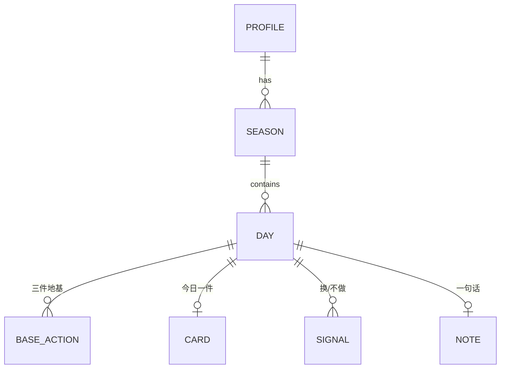

# 001 · 人生游戏（生命力系统）

- **状态**：draft（需求 v2 已收口 · 蓝图待评审；未 approved 不允许写码）
- **创建**：2026-11-25
- **档案阶段**：第 1 步 需求（v1 三轮 + v2 变更）→ 第 2 步 蓝图 → 第 3 步 评审（进行中）
- **v2 变更**：按「极简主义 / 第一等级 / 四字目标 / 常开 Mac / 日期推荐」重做，把 v1 的 7 屏砍到 3 屏

---

## 1. 背景与症状

大厂在职，收入尚可，晋升空间有限；出差频繁（不固定，看项目），可自主支配时间多。

| 症状 | 描述 |
|------|------|
| 空虚 | 一天天上班，没有进步，每天处于「无任务状态」 |
| 懈怠 | 有任务时也很容易懈怠 |
| 专注力差 | 阅读专注力下降，专注力非常不够 |
| 机能下降 | 身体机能在降低 |
| 好奇心下降 | 对外界的探索欲在降低 |
| 浮躁 | 心态浮躁，需要先降下来（v1 已确认为报复性熬夜 + 刷手机） |

**作息事实**：01:30–02:00 睡，09:00 起；约 18:00–19:00 下班，通勤很近；不出差时公司—住处两点一线。
→ 每天有 **6.5 小时**完全自主时间，但没有归属。这是空虚的结构性来源。

**已启动的正向变化**：最近开始冥想（每天 10 分钟），健身重新启动。

---

## 2. 根因假设（已确认）

1. **反馈闭环缺失**：努力与回报脱钩，做了事没人看见、没有积累感。
2. **节律缺失**：无任务态不是懒，是日程里没有「被期待的事」。人是被「下一个期待」驱动的。
3. **低刺激沉浸入口缺失**：注意力阈值被高刺激内容抬高，读书/运动这类「低刺激高回报」的事启动成本极高。

### 三条反直觉判断（已认可）

- **R1**：继续推荐更多好内容会加重问题。内容必须是**处方**（限量、有疗程），不是信息流。
- **R2**：不能再叠积分/等级/连续打卡。度量用体验型指标，不用完成率。
- **R3**：主动 ≠ 随时推送。主动 = 固定节律点出现 + 选择权在人手上。

### v2 新增判断

- **R4（极简优先）**：任何需要用户「做决定」的地方都要砍掉或后置。**能替用户决定就替他决定**，只在结果上给他「换一个 / 不做」的否决权。
- **R5（分层优先）**：地基动作（冥想/健身/睡觉）与趣味推荐（读书/看展/约人）**不在同一个池子里竞争**。混在一起会让地基被趣味挤掉。

---

## 3. 产品主张

> 一个**只在一屏里每天陪你的极简系统**。它替你做决定，你只需要三个动作：**做 / 换一个 / 不做**。

日常只记录不计算；计算交给 Agent 每周做一次。

---

## 4. 四字目标模型（用户自己的话）

**充实 · 轻盈 · 专注 · 健康**

| 维度 | 定义（可测的代理指标） | 每日信号 |
|------|------------------------|----------|
| **健康** | 睡得够 + 身体在动 | 昨晚睡眠时长、是否运动 |
| **专注** | 有注意力训练 + 有沉浸时间 | 冥想是否完成、深度时段分钟 |
| **轻盈** | 睡前那一小时怎么过的 + 今天的心理感受 | 睡前是否离床、感受分 |
| **充实** | 今天有没有留下东西 | 今天一件是否完成、是否写了那句话 |

说明：这是**代理指标不是精确测量**。极简原则下宁可用粗糙但真实的信号，不要精确但没人填的问卷。

> 🔴 **待确认**：「轻盈」是否就是这个意思（身体的轻 + 心里不积压）？如果你指的是别的（比如物欲/体重/房间整洁），现在改成本最低。

---

## 5. 两级动作模型（v2 核心）

| 等级 | 内容 | 频率 | 谁决定 |
|------|------|------|--------|
| **第一等级 · 地基** | 冥想 10 分钟 / 动一动 20 分钟 / 睡前把手机放到客厅 | 每天固定三件 | 固定，**不推荐、不变化** |
| **第二等级 · 趣味** | 阅读、长电影、探索、审美、连接、创造 | 每天**一件** | Agent 推荐，用户可换/可不做 |

**为什么这样分**：地基是「让生命力回来」，趣味是「让生活有趣」。地基不需要意志力和灵感，趣味才需要选择。混在一起，地基永远打不过趣味。

---

## 6. 推荐引擎（v2 新增 · 核心）

每天 **09:10** 由 Agent 生成一张卡（只有一张）。

**输入信号**

1. 四维近 14 天数据 → 找出最弱的一维
2. 当前日期 / 节气 / 节日（例：2026-11-26 是感恩节）
3. 最近 14 天做过什么 → 去重
4. 今天的场景（在家 / 公司 / 出差）
5. 昨晚睡眠（睡太晚 → 给低消耗的）

**输出结构**

```json
{
  "title": "给一个很久没联系的人发条消息",
  "why": "充实这一维两周没动过；今天是感恩节。只要 5 分钟。",
  "minutes": 5,
  "budget": 0,
  "scene": "home",
  "dimension": "充实",
  "source": "calendar"
}
```

**三个操作**：`做` / `换一个` / `今天不做`。后两个都记信号，用于调参。

**节日/日期推荐的定位**：不是内容库，是**惊喜触发器**。它解决「人生有没有创意」这个问题，成本极低。

---

## 7. 系统结构（v2 压缩为三层）

```
采集层   本地 Web App（PWA）：三件地基打勾、今天一件、一句话、周复盘
          ↓ data/db.json（唯一真相源）
决策层   DSH 会话（Agent）：读数据 → 写今日卡 / 周复盘叙事
          ↑
唤醒层   DSH 调度：09:10（今日卡）/ 周日晚（复盘）
```

---

## 8. 首版范围（极简 MVP · 3 屏）

| 屏 | 文件 | 内容 |
|----|------|------|
| **今天** | `design/today.html` | 简报一句 + 三件地基打勾 + 今天一件（做/换/不做）+ 一句话 |
| **这周** | `design/week.html` | 四维横条 + 一句诊断 + 本周留下的 5 条 |
| **我** | `design/me.html` | 四字目标、当前季、下一季预告、四个设置项、数据导出 |

**不在 MVP**：菜单选择、证据照片、年鉴、形象购物、内容库、社交、多用户、出差模式开关（改为自动推断）。

---

## 9. 非目标

- 不做积分、等级、排行榜、连续打卡
- 不做社交
- 不做无限内容流
- 不自动排满日程（必须留白）
- 不做医疗/健康建议
- **不做需要用户主动规划的功能**（极简原则）

---

## 10. 用户故事

- **US1** 作为用户，我早上打开只有一屏，看到昨晚睡眠 + 三件地基 + 一张今日卡，10 秒能看懂。
- **US2** 作为用户，我不想选的时候，系统直接给我一件；不满意我点「换一个」。
- **US3** 作为用户，三件地基是固定的，不需要我思考今天要不要冥想。
- **US4** 作为用户，周日我只看一眼四维横条和一句诊断，不做任何规划。
- **US5** 作为用户，出差时没有网也能打开、能打勾，回到网络自动同步。
- **US6** 作为用户，我连续几天什么都没做时，系统不催我、不显示中断，只把剂量调低。

---

## 11. 验收标准

- **AC1** Given 我早上 09:10 后打开应用，When 首页加载完成，Then 一屏内同时看到：昨晚睡眠、三件地基、一张今日卡；无需滚动即可看到今日卡标题。
- **AC2** Given 今日卡不满意，When 点「换一个」，Then 3 秒内换一张不同卡片，且原卡记录为 skipped。
- **AC3** Given 我点「今天不做」，When 提交，Then 记 skipped 且**不出现任何劝阻或失败措辞**。
- **AC4** Given 我连续 3 天没有任何勾选，When 打开应用，Then 页面正常显示，且今日卡自动降为 ≤10 分钟的版本。
- **AC5** Given 我离线打勾 3 项，When 恢复网络，Then 3 条记录自动同步且不重复。
- **AC6** Given 今天是 11/26 感恩节，When 生成今日卡，Then 卡片 `source` 为 calendar 且 why 里说明了节日依据。
- **AC7** Given 一周结束，When 打开「这周」，Then 四维各自有一个 0–7 的达成天数与一句诊断，无完成率、无排名。

---

## 12. 不良路径与边界

| 场景 | 期望行为 |
|------|----------|
| Agent 未按时产出今日卡 | 用「昨日卡 + 降级默认动作」兜底，界面不空白、不报错 |
| inbox JSON 损坏 | 忽略该文件并记录 parse_error，界面照常可用 |
| 离线 | 读本地缓存，写入进队列，联网重放（幂等） |
| 出差（陌生城市） | 今日卡自动偏向「探索」，场景字段由城市变化推断 |
| 睡太晚（>02:00） | 今日卡自动降档，不给消耗大的事 |
| 用户长期不上线 | 只降频不催命：第 7 天一条「这周不用做什么」，第 21 天停推 |
| 节假日误判 | 卡片标注依据，用户可「换一个」直接覆盖 |

---

## 13. 决策记录

| 编号 | 决策 | 结论 | 版本 |
|------|------|------|------|
| Q1 | 用户范围 | 只给自己用，单用户无登录 | v1 |
| Q2 | 形态 | 本地 Web App + 每日简报 | v1 |
| Q3 | MVP | 先做日常闭环，不做内容库 | v1 |
| Q4 | 数据来源 | 纯手动，预留健康/日历接口 | v1 |
| Q5 | 简报通道 | DSH 原生唤醒链 + DSH Go | v1 |
| Q6 | 降噪力度 | 温和起步，两周后加码 | v1 |
| Q7 | 作息 | 01:30–02:00 睡 / 09:00 起 | v1 |
| Q8 | 每日投入 | 系统交互 10 分钟 + 一个 30 分钟动作 | v1 |
| **Q9** | 部署形态 | **部署到另一台常开的 Mac 作为常驻服务** | v2 |
| **Q10** | 离线 | **离线可用**（见 §14 的更简实现） | v2 |
| **Q11** | 四维模型 | 用用户自己的词：充实/轻盈/专注/健康 | v2 |
| **Q12** | 交付形态 | **极简优先**：3 屏，能砍就砍 | v2 |
| **Q13** | 选择方式 | **取消周菜单选择**，改为每日推荐一件 + 换一个 | v2 |
| **Q14** | 内容储备 | **第二季（重启身体季）现在就备好** | v2 |

### v1 → v2 的重要变更

| 变了什么 | v1 | v2 | 为什么 |
|---|---|---|---|
| 维度模型 | 五维（身体/专注/探索/审美/连接） | **四维（充实/轻盈/专注/健康）** | 用户自己的话更准 |
| 选择权 | 每周从 3–5 张卡里选 1–3 个 | **每天给一件，可换可不做** | 用户无目标性 + 极简 |
| 层级 | 单一池子 | **第一等级地基 / 第二等级趣味** | 地基不能被趣味挤掉 |
| 屏数 | 7 屏 | **3 屏** | 极简 |
| 雷达 | 五维雷达图 | **四维横条** | 雷达看着专业，读起来累 |
| 出差 | 手动开关 | **自动推断** | 少一个需要用户做的事 |
| 同步 | last-write-wins 双写 | **服务端唯一真相源 + 离线队列重放** | 少一半逻辑 |

---

## 14. 架构（常开 Mac + 离线队列）

```
[手机 PWA]  ←HTTP→  [常开 Mac：静态资源 + 极小 API]
                          ↓
                     data/db.json   ← 唯一真相源（带 rev）
                          ↑
                  [DSH 会话（Agent）] ← 09:10 / 周日晚 由调度唤醒
```

**离线怎么做到极简**：不做双向同步。手机端只做两件事——缓存最后一次读到的 db 快照、把没发出去的写操作放进队列；恢复网络后按序重放（每条写带唯一 `opId`，服务端幂等去重）。服务端永远是唯一真相源，不存在两写冲突。

> 这比 v1 设想的 last-write-wins 简单一半，且完全满足出差可用。

**部署前提**（待确认）：常开的那台 Mac 需要装 DSH 并接上 DSH Go，才能做到「主动唤醒」。

---

## 15. 蓝图

### 15.1 界面全局（3 屏）

| 屏 | 作用 | 出去 |
|----|------|------|
| **今天** `today.html` | 简报 + 三件地基 + 今天一件 + 一句话 | 无跳转（唯一日常入口） |
| **这周** `week.html` | 四维横条 + 一句诊断 + 本周 5 条 | ← 今天 |
| **我** `me.html` | 目标/季/设置/导出 | ← 今天 |

**为什么只有 3 屏**：日常只需要一屏。周复盘一周看一次，设置一次看一次。任何第 4 个日常屏都是负担。

### 15.2 数据全局



| 文件 | 唯一写入者 | 内容 |
|------|-----------|------|
| `data/db.json` | 服务端 API | profile / season / day / base_action / card / signal / note；带 `rev` |
| `data/inbox/card-YYYY-MM-DD.json` | Agent | 今日卡（含 why / source） |
| `data/inbox/review-YYYY-Www.json` | Agent | 周复盘叙事 |

**四条不变量**：
1. app 只通过 API 写 db，Agent 只写 inbox —— 不存在并发写。
2. 每条离线写都带 `opId`，服务端幂等去重。
3. 今日卡缺失时用降级动作兜底，任何情况下首页不空白。
4. 四维只在周复盘计算，日常不计算。

### 15.3 交付全局（5 片，每片可独立验证）

| 片 | 范围 | 验证方式 |
|----|------|----------|
| **S1** | 数据层 + 今天屏（三件地基能打勾、能写一句话） | 在本机跑起来，真的用它过一天 |
| **S2** | 今日卡（先用本地规则生成，不接 Agent）+ 换一个/不做 | 点十次「换一个」，看卡片是否合理 |
| **S3** | 这周屏（四维横条 + 诊断）+ 我（设置） | 造 7 天假数据，检查数字对不对 |
| **S4** | 接 Agent + 09:10 唤醒 + 节日/节气推荐 | 真实跑一周，看主动唤醒是否到手机 |
| **S5** | 部署常开 Mac + 离线队列 + DSH Go | 出差时实测离线打勾再同步 |

---

## 16. 评审三问

**① 改哪层** — 三层：`app/`（PWA 采集呈现）、`api/`（读写 db.json，极小）、`agent/`（读 db 出卡与复盘）。不越层，唯一耦合面是 `data/`。

**② 数据怎么流，失败怎样** — 见 §15.2 四条不变量。失败兜底：Agent 没出卡 → 用降级默认；inbox 坏 → 忽略；离线 → 队列重放；睡太晚 → 自动降档。

**③ 怎么验证** — 每片都有「真实用一天」的验证方式（上表），不靠单测假装通过。数据层单测覆盖 rev 递增、opId 幂等、坏 JSON 容错；四维计算单测覆盖空数据不出 NaN。

**更简单的做法我都试过了**：只做 Todo（解决不了期待感）、用现成打卡 App（正好是要避开的积分机制）、只做 DSH 会话（雷达和积累留不住）。v2 已经是这些方案里最简单的一条。

---

## 17. 第二季储备（Q14）

降噪季只有 14 天，第二季需要**现在备好**，否则第一季结束就会出现断层（正好是产品最容易死的时候）。

- **第二季：重启身体季**（14 天）——重心从「睡前」转到「白天」：力量训练渐进、通勤步行、体感轻盈。
- 备好的东西：14 天的今日卡池（含 why）、四维权重调整、加码规则。
- 第三季候选：城市漫游季 / 审美启蒙季。

---

## 18. 调研种子

- 人生清单范式：[100 件事](http://mp.weixin.qq.com/s?__biz=MzI4NDA2MDMxMQ==&mid=2649015256&idx=1&sn=01702909e541db7080eb8ca43b58f457)
- 生活方式范式：[100 种有趣的生活方式](http://mp.weixin.qq.com/s?__biz=Mzk5MDY3NTYyOQ==&mid=2247560142&idx=2&sn=9811d1b8bb05dcd748456cd32abc8c9d)（自我定位：「不是任务清单，是提醒」）
- 专注与数字极简：[《深度工作》《数字极简》](https://earsonme.com/episodes/021iNxF4QY0w)
- 心力与认知能量：[36 氪](https://36kr.com/p/3431219205803399)
- 好奇心可随年龄保持甚至增长：[UCLA Castel](https://www.ucla.edu/research/article/aging)
- 博物馆/城市审美主线：[播客](https://podcasts.apple.com/sg/podcast/vol-74-%E8%B7%9F%E7%9D%80-%E5%8D%88%E5%A4%9C%E5%B7%B4%E9%BB%8E%E9%80%9B%E5%8D%9A%E7%89%A9%E9%A6%86-%E5%9B%9E%E5%88%B0%E6%B5%B7%E6%98%8E%E5%A8%81%E4%B8%8E%E5%8D%B0%E8%B1%A1%E6%B4%BE%E7%9A%84%E9%BB%84%E9%87%91%E6%97%B6%E4%BB%A3/id1725592948?i=1000766394411)
