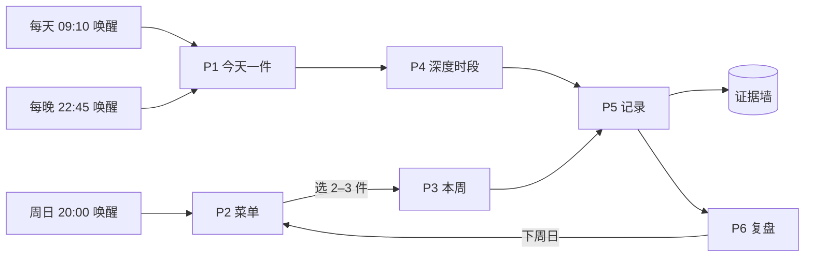
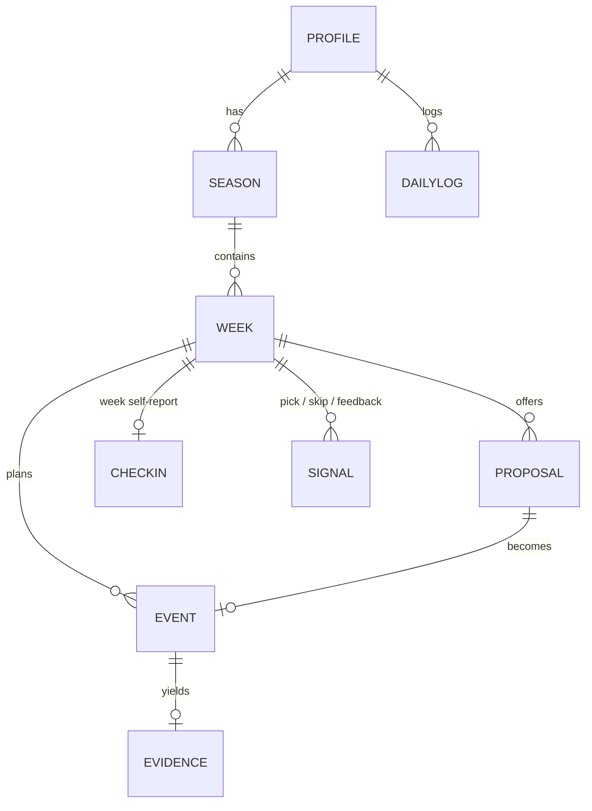

# 001 · 生命力系统（暂名「人生游戏」）

- **状态**：draft（需求已收口 · 蓝图待评审；未 approved 不允许写码）
- **创建**：2026-11-25
- **档案阶段**：第 1 步 需求拷问（已完成）→ 第 2 步 蓝图（已出）→ 第 3 步 方案评审（进行中）/ L 档全程流程

---

## 1. 背景与症状

用户为大厂在职员工，收入尚可，晋升空间有限；出差频繁，可自主支配的碎片与整块时间较多。

自述症状（原话归并）：

| 编号 | 症状 | 主观描述 |
|------|------|----------|
| S1 | 空虚感 | 一天天上班，没有进步，每天处于「无任务状态」 |
| S2 | 懈怠 | 有任务时也很容易懈怠 |
| S3 | 专注力差 | 专注力非常不够，阅读专注力下降 |
| S4 | 机能下降 | 身体机能在降低 |
| S5 | 好奇心/探索欲下降 | 对外界的探索欲在降低 |
| S6 | 物欲下降 | 连物欲都在降低，显得没有生命力和活力 |
| S7 | 浮躁 | 心态浮躁，需要先降下来 |

**目标**：提升生命力、专注力、身体机能，让生活充盈、幸福。

---

## 2. 根因假设（待用户挑战）

不把问题归因为「意志力不够」。三个结构性缺失：

1. **反馈闭环缺失**：努力与回报脱钩（晋升无空间 → 动机系统失效）。生活里同样：做了事没人看见、没有积累感。→ 需要**可见的进度与证据**。
2. **节律缺失**：无任务态不等于懒，而是日程里没有「被期待的事」。人是被「下一个期待」驱动的。→ 系统的核心职责是**制造值得期待的下一个事件**。
3. **低刺激沉浸入口缺失**：注意力阈值被高刺激内容抬高（短视频/信息流/工作消息），导致读书、运动这类「低刺激高回报」的事启动成本极高。→ 需要**封箱式的沉浸设计**，而不是更多内容推荐。

### 反直觉判断（需明确认可）

- **R1**：继续「推荐更多好内容」会加重问题。内容库在本产品里必须是**处方药**（限量、有疗程），不是信息流。
- **R2**：大厂用户已被 KPI 规训，**不能**再叠一层积分/等级/连续打卡。度量必须是体验型指标（期待感、沉浸时长、事后愉悦度）。
- **R3**：主动性 ≠ 随时推送。主动 = **固定节律点出现**，选择权始终在用户手上。

---

## 3. 产品主张（一句话）

一个**主动式的生命力操盘手**：每周给一份「值得期待的事件清单」（而非任务清单），每天只在固定节律点出现，把身体、专注、探索、审美、连接五条线从「随缘」变成「有节奏的积累」，并用证据与叙事沉淀成一年后可回看的「生命力年鉴」。

---

## 4. 五维生命力模型

| 维度 | 含义 | 典型行为 | 数据来源 |
|------|------|----------|----------|
| 身体 Body | 睡眠、运动、饮食 | 力量/有氧、作息、吃饭质量 | 自评 +（可选）健康数据 |
| 专注 Focus | 深度时段、数字节流 | 深度阅读、无手机时段、心流活动 | 计时记录 |
| 探索 Explore | 新地方、新体验、新朋友 | 城市漫游、博物馆、旅行、陌生人 | 事件记录 |
| 审美 Aesthetic | 艺术、音乐、设计、穿搭 | 看展、看片、穿搭、好物 | 事件记录 |
| 连接 Connect | 朋友、家人、社群 | 约人、深度对话、共同体验 | 事件记录 |

诊断输出：五维雷达 + 本周短板 + 一句人话诊断（不做分数排名）。

---

## 5. 系统五层

```
L0 诊断层（Diagnosis）
   周度自评 5 题 + 行为数据 → 五维雷达 → 短板识别
                │
L1 提案引擎（Prescription）★核心
   每周 3–5 个候选事件（卡片化：能量/时间/场景/预算/沉浸度/新鲜度）
   用户选 1–3 个 → 进本周 → 完成反馈回流调参
   主题季（Season）把零散事件串成 6–8 周叙事
                │
L2 日常节律（Rhythm）
   晨间「今天一件」/ 午间吃饭 / 傍晚运动档 / 夜间收工仪式 / 周日复盘
                │
L3 沉浸引擎（Flow）
   专注力渐进负荷 25→45→90 分钟；封箱体验（一个下午一本书 / 90 分钟无手机电影 / 无目的漫步）
                │
L4 内容与资产库（Library）
   书/影/展/播客/店/城市点位；预置精选基线 + 出差城市点位 + 按需联网补充
                │
L5 形象与审美支线（Style，后期）
   穿搭/仪容/少而准的好物；反消费主义
```

**主题季设计（首季建议「降噪季」）**：用户明确要求先降浮躁，故第一季不走「更努力」路线，走「减少输入 + 恢复沉浸」路线。

候选季节序列：① 降噪季（数字节流、深度阅读、睡眠仪式）→ ② 重启身体季 → ③ 城市漫游季 → ④ 审美启蒙季 → ⑤ 陌生人季。

**出差模式（差异化关键）**：识别到出差城市后，自动切换为「1 个城市探索点 + 1 种当地吃法 + 酒店内 15 分钟训练 + 碎片深度阅读」四件套。

---

## 6. 首版范围（待拍板）

推荐 MVP = 「降噪季」最小闭环：

- 五维周度自评（1 分钟）
- 本周菜单（3–5 候选 → 选中 1–3 → 我的本周）
- 每日节律：晨间「今天一件」+ 夜间收工仪式
- 事件记录：完成 + 一句话 + 情绪分（+ 照片）
- 周复盘：雷达变化 + 本周证据 + 下周菜单入口
- 低电量模式：连续未记录不惩罚，只降级给 5 分钟动作

**不在 MVP**：形象/购物、完整内容库、社交、多用户、真推送（视形态决策）。

---

## 7. 非目标（明确不做）

- 不做积分、等级、排行榜、连续打卡惩罚
- 不做社交/好友/公开打卡
- 不做无限内容信息流
- 不做全自动排满日程（必须留白）
- 不做医疗或健康诊断建议
- 不以「完成率」作为用户可见的成功指标

---

## 8. 用户故事（初稿）

- **US1** 作为用户，周日晚上我收到本周菜单（3–5 个候选事件），我挑 1–3 个加入本周。
- **US2** 作为用户，每天早上我拿到「今天一件」（≤20 分钟的具体动作），做完可一键记录。
- **US3** 作为用户，我到陌生城市出差时，系统自动给我该城的探索点 + 当地吃法 + 酒店内训练。
- **US4** 作为用户，当我连续几天什么都没做时，系统不惩罚我，只给 5 分钟降级版本。
- **US5** 作为用户，周日复盘我能看到五维雷达变化与本周 3 条证据（照片/一句话）。
- **US6** 作为用户，我可以跳过整周，系统只问一句原因，用于调参。

---

## 9. 验收标准（初稿，待补全）

- **AC1** Given 周日 20:00 打开复盘页，When 页面加载完成，Then 展示 3–5 个候选事件，每个含「时间成本 / 能量成本 / 场景 / 预算 / 为什么推荐」，且其中至少 1 个可在当前所在地或下周出差地完成。
- **AC2** Given 我选中 2 个候选，When 进入本周，Then 它们出现在本周事件列表并带建议日期；同类事件在下一轮不再重复推荐。
- **AC3** Given 我连续 3 天未记录，When 打开应用，Then 不出现任何「中断 / 失败 / 断签」措辞，只出现降级版 5 分钟动作。
- **AC4** Given 我完成一个事件并记录情绪分，When 打开雷达，Then 对应维度数值有可见变化，并展示该事件为证据。
- **AC5** Given 本周我一个都没选，When 提交，Then 系统记录原因并只调整下周推荐，不弹出劝阻。

---

## 10. 不良路径与边界

| 场景 | 期望行为 |
|------|----------|
| 无网络 | 本地库可用，联网补充降级为「暂缺」，不阻塞 |
| 提案质量差（重复/不可行/超预算） | 提供「换一批」+「太贵/太难/没兴趣」三个负反馈按钮，回流调参 |
| 用户全选 | 提示上限 3，并要求排序 |
| 出差城市无数据 | 退化为通用事件（酒店训练 / 深度阅读 / 随机漫步） |
| 情绪分留空 | 允许，但复盘时标记「无感受数据」 |
| 时区与出差地错位 | 以本地时间为准，节律点跟随设备时区 |
| 用户长期不上线 | 只降频不催命：第 7 天一条「这周不用做什么」，第 21 天停推 |

---

## 11. 决策记录

### 已拍板（2026-11-25，第一、二轮）

| 编号 | 决策 | 结论 |
|------|------|------|
| Q1 | 用户范围 | **只给自己用**：单用户、无登录、数据全部本机 |
| Q2 | 形态与主动触达 | **本地 Web App + 每天一条简报** |
| Q3 | MVP 范围 | **降噪季闭环**（诊断 + 周菜单 + 每日节律 + 事件记录 + 周复盘） |
| Q4 | 数据来源 | **纯手动自评 + 事件记录**，架构上预留健康/日历接口 |
| Q5 | 简报通道 | 优先走 **DSH 原生唤醒链**（调度唤醒 + DSH Remote + DSH Go）；飞书/Telegram 作为备选适配器 |
| Q6 | 降噪力度 | **温和起步，两周后加码**：每日 1×45 分钟深度时段 + 睡前 30 分钟无手机 + 周日无屏半天 |
| Q7 | 作息（事实） | **01:30–02:00 睡，09:00 起**；不出差时公司—住处两点一线 |
| Q8 | 每日投入 | 系统交互 **10 分钟** + 一个 **30 分钟**真实动作 |

### 由决策推出的结论

- 无账号/无后端 → 不需要云、不需要鉴权、不需要部署；数据层用本地 SQLite。
- 主动性由「DSH 定时唤醒 + 会话投递」承担，因此**简报必须短到能在一条通知里读完**（≤60 字），长内容留在 app。
- 第一季成败标准：两周后深度时段是否从 0 变成每周 3 次。

### 待拍板（第三轮）

| 编号 | 决策 | 状态 |
|------|------|------|
| Q9 | 手机平台与 DSH Go 可用性 | 待答 |
| Q10 | 下班时间与通勤时长 | 待答 |
| Q11 | 出差频率与形态 | 待答 |
| Q12 | 晚睡主因（降噪靶点） | 待答 |
| Q13 | 每月体验预算（开放题） | 待答 |

---

## 13. 架构与主动唤醒层（草案）

**已核实的事实（2026-11-25）**：

- **DSH Go** 是社区开发的第三方 Android 客户端（非官方），可通过 DSH Remote 连接宿主机上的 DSH，实时同步消息与任务进度；Android 8+。
- **dsh-proactive** 提供 host 级主动唤醒：`proactive_set` 设单次/间隔/cron 闹钟，到点唤醒冷会话执行心跳；带安静时段与每日投递预算。
- **dsh-clock** 可唤醒已关闭的会话并投递关键词。
- 内置 `schedule_create` 为会话内投递（把消息作为用户消息在指定时间送到该会话）。

结论：**本案不自己造 LLM 调用层，也不自己造推送通道**，直接复用 DSH 的调度和会话投递能力。

```
[本地 Web App]  ←→  [本地 SQLite]  ←→  [DSH 会话（Agent 大脑）]
  UI / 记录 / 雷达       数据真相源        提案生成 · 简报撰写 · 周复盘
                                                  ↑
                                        [DSH 调度（cron 唤醒）]
                                                  ↓
                                    [投递适配器：DSH Go / 飞书 / Telegram]
```

**三条铁律**：

1. **数据真相源在本地 SQLite**，Agent 只是读写它的「工作人员」；换 Agent、换模型都不丢数据。
2. **唤醒层是适配器**，先接 DSH 原生链路，飞书/Telegram 作为 fallback；不为某个通道写死逻辑。
3. **简报预算**：通知里 ≤ 60 字 + 一个动作；详情留在 app 内。

---

## 14. 蓝图（三视图）

### 14.1 界面全局 · 页面清单

原型目录：`design/`（可直接点击走查，7 屏）

| 编号 | 屏 | 文件 | 作用 | 出去 |
|------|----|------|------|------|
| P0 | 设置 | `setup.html` | 首次定四个数：睡眠目标 / 深度时段 / 月预算 / 运动水平 | → P2 |
| P1 | 今天 | `today.html` | 昨夜简报 + 今天一件 + 加餐 + 收工入口 | → P4 / P5 |
| P2 | 本周菜单 | `menu.html` | 3–5 张候选事件卡，最多选 3；带负反馈出口 | → P3 |
| P3 | 本周 | `week.html` | 已选事件、进度、出差模式开关 | → P2 / P5 |
| P4 | 深度时段 | `focus.html` | 全屏沉浸计时，屏幕上没有任何通知入口 | → P5 |
| P5 | 记录 | `record.html` | 情绪分 + 一句话 + 照片 → 进证据墙 | → P1 |
| P6 | 复盘 | `review.html` | 体验指标 + 五维雷达 + 证据墙 + 下周菜单 | → P2 |

**设计原则落地**：

- 一屏一个焦点：P1 的焦点是「今天一件」，P6 的焦点是雷达。
- 主色只用在关键动作和细线上；层级靠表面色深浅（`--surface` / `--surface-2` / `--surface-3`）。
- 体验指标放在复盘最上面两位：「带着期待起床 N/7 天」与「深度时段合计分钟」——**不出现完成率**。
- 任何地方都没有红点、未读、连续天数。

### 14.2 用户旅程



### 14.3 数据全局

**实体与关系**



| 实体 | 关键字段 |
|------|----------|
| profile | sleep_target, depth_slot, monthly_budget, fitness_level, travel_mode |
| season | name（降噪季）, day_index, total_days(14), rule_addon（两周后加码阈值） |
| week | week_id, range, menu_generated_at |
| proposal | dimension, title, why, minutes, budget, scene(home/city/travel), novelty, energy, status(offered/chosen/skipped) |
| event | proposal_id, planned_at, done_at, duration, status |
| evidence | event_id, mood(1–5), one_line, photo_path, dimension |
| checkin | week_id, body/focus/explore/aesthetic/connect（1–5）, note |
| dailylog | date, sleep_at, wake_at, movement, meal_quality |
| signal | week_id, proposal_id, kind(pick/skip), reason |

**数据契约：文件即接口（不做服务端）**

| 文件 | 唯一写入者 | 读取者 | 内容 |
|------|-----------|--------|------|
| `data/db.json` | **app** | app / Agent | 全部实体；带 `rev` 单调递增 |
| `data/inbox/briefing-YYYY-MM-DD.json` | **Agent** | app | 今日简报 + 今天一件 + 加餐 + 依据 |
| `data/inbox/menu-YYYY-Www.json` | **Agent** | app | 一周 3–5 张候选 + `basis` + `max_pick` |

**关键约束：单一写入者。** app 独占写 `db.json`，Agent 独占写 `inbox/`，两边都不碰对方的文件 → 不存在并发写冲突，也不需要锁。

**三层职责**

| 层 | 是谁 | 只做 |
|----|------|------|
| 采集与呈现 | 本地 Web App | 记录、计时、算五维、渲染 |
| 决策与书写 | DSH 会话（Agent） | 读 db → 写 briefing / menu / 复盘叙事 |
| 唤醒 | DSH 调度（cron） | 09:10 / 22:45 / 周日 20:00 三个点 |

### 14.4 交付全局 · 切片地图

| 片 | 范围 | 对应屏 | 交付后能干什么 | 预估 |
|----|------|--------|----------------|------|
| S1 | 项目骨架 + 数据层（db.json 读写 + rev）+ 今天屏 | P1 | 打开就能看到「今天一件」 | ~300 行 |
| S2 | 记录 + 证据写入 + 情绪分 | P5 | 做完了能留下证据 | ~250 行 |
| S3 | 菜单选择 + 本周事件 + 信号回流 | P2 / P3 | 提案能被选、被跳过 | ~350 行 |
| S4 | 深度时段计时 + 五维计算 + 复盘雷达 | P4 / P6 | 能看到自己在变 | ~350 行 |
| S5 | Agent 契约 + DSH 调度唤醒 + 简报生成 | — | 它开始主动找你 | ~300 行 |
| S6 | 设置 + 出差模式 + 降噪季加码 | P0 / P3 | 能长期跑下去 | ~300 行 |

**验收环境的硬要求**：一条命令拉起（`pnpm start` 起本地服务 + 打开今天屏），且数据目录可清空重置到演示状态。

---

## 15. 方案评审（三问）

### ① 改哪层，有没有越层

全新项目，分层如下，**不存在越层**：

- `app/` 只做「采集 + 呈现 + 计算」，不认识 DSH；
- `agent/` 只做「读 db → 出文稿」，不直接改 UI 状态；
- `scheduler` 只做「按时唤醒」，不含业务判断；
- 三者唯一耦合面是 `data/` 下的两个文件契约。

### ② 数据怎么流，失败时怎样

- 写入：app 写 `db.json`（带 rev），Agent 只读；Agent 产出落 `inbox/`，app 读取后标记 consumed。
- 失败：
  - Agent 没按时产出简报 → app 用「昨日简报 + 今天一件默认动作」兜底，不空白、不报错；
  - `inbox` 里 JSON 格式坏了 → app 忽略该文件并记录一条 `parse_error`，界面照常可用；
  - app 与 Agent 同时想写 → 结构上不可能（唯一写入者约束）；
  - 手机连不上本机服务 → 只读最后一次快照，写入进本地队列（**是否要做取决于 §16-1**）。

### ③ 怎么验证，覆盖哪些行为

| 层 | 验证方式 |
|----|----------|
| 数据层 | 单元测试：rev 递增、并发写拒绝、坏 JSON 容错、inbox 幂等消费 |
| 五维计算 | 单元测试：给定事件与自评，雷达值符合公式；空数据不出现 NaN |
| 界面 | 逐屏对照 `design/` 原型；`check_design` 已实测 7 屏 × 2 尺寸无截断/重叠/压栏问题 |
| 关键行为 | ① 连续 3 天无记录 → 不出现"中断/失败"字样；② 全选 4 个 → 被挡在第 3 个；③ 跳过全部 → 记下原因且不弹劝阻；④ 无网络 → 界面可用 |
| 端到端 | 周日菜单 → 选中 → 本周 → 完成 → 记录 → 复盘雷达变化，一条链在真实环境走通 |

### 有没有更简单的做法？为什么不选

- **更简单：只做一个 Todo + 提醒**。不选，因为它解决不了「无期待感」，只会变成又一个待办清单。
- **更简单：直接接现成习惯打卡 App**。不选，因为积分/连续打卡正是要避开的东西（R2），且无法做「提案 + 证据 + 年鉴」。
- **更简单：把简报直接塞进 DSH 会话，不做 Web App**。不选，因为雷达、证据、年鉴需要长期可视化，纯对话留不住。

---

## 16. 评审时需豆浆拍板的遗留取舍

1. **出差时本机服务可达吗？** 出差是本产品最值钱的场景，但若 Mac 不在身边，`data/` 就读不到。
   - 选项 A（推荐）：MVP 先假设「在不在都能用」——app 走离线优先，数据存手机本地，与 `db.json` 做 last-write-wins 同步。
   - 选项 B：MVP 只做「Mac 在线时可用」，出差时降级为只读快照，同步留到 S7。
2. **降噪季只有 14 天，之后呢？** 是否现在就备好第二季（重启身体季）的候选池，还是等第一季跑完再生成。


---

## 12. 背景调研记录

已检索到的参考基线（内容库首批种子，非最终结论）：

- 人生清单范式：100 件事清单（体验/旅行/休闲/技能四类）— [人生清单 | 想要实现的100件事](http://mp.weixin.qq.com/s?__biz=MzI4NDA2MDMxMQ==&mid=2649015256&idx=1&sn=01702909e541db7080eb8ca43b58f457)、[人生要做的100件事](https://www.meipian.cn/5p99rs4h)
- 生活方式范式：按「锚定自己的时刻 / 让平凡日子变好看 / …」分类，强调「不是任务清单，是提醒」— [100种有趣的生活方式](http://mp.weixin.qq.com/s?__biz=Mzk5MDY3NTYyOQ==&mid=2247560142&idx=2&sn=9811d1b8bb05dcd748456cd32abc8c9d)
- 专注与数字极简方法论：深度工作四哲学、仪式感、时间压缩、30 天数字清理 — [《深度工作》《数字极简》](https://earsonme.com/episodes/021iNxF4QY0w)
- 心力/心流与认知能量管理 — [决定一个人能走多远的，是心力](https://36kr.com/p/3431219205803399)
- 好奇心可随年龄保持甚至增长，且与认知衰退负相关（UCLA Castel 等）— [What's the trick to aging well?](https://www.ucla.edu/research/article/aging)
- 博物馆/城市审美作为旅行主线的方法 — [跟着《午夜巴黎》逛博物馆](https://podcasts.apple.com/sg/podcast/vol-74-%E8%B7%9F%E7%9D%80-%E5%8D%88%E5%A4%9C%E5%B7%B4%E9%BB%8E%E9%80%9B%E5%8D%9A%E7%89%A9%E9%A6%86-%E5%9B%9E%E5%88%B0%E6%B5%B7%E6%98%8E%E5%A8%81%E4%B8%8E%E5%8D%B0%E8%B1%A1%E6%B4%BE%E7%9A%84%E9%BB%84%E9%87%91%E6%97%B6%E4%BB%A3/id1725592948?i=1000766394411)

> 内容策略待 Q3 拍板后展开，本处仅作种子记录，不作为需求结论。
